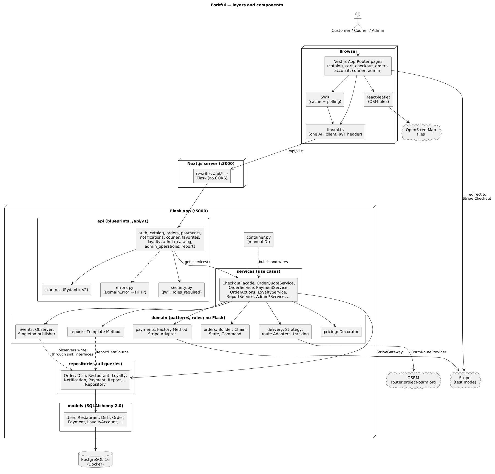

# Architecture

Forkful is a single-page web app (Next.js) talking to a REST API (Flask) backed by PostgreSQL. The backend is split into layers, and dependencies point inward.



## Backend layers

```
api (blueprints, schemas)  →  services (use cases, facade)  →  domain (patterns, business rules)
                                         ↓
                              repositories  →  models (SQLAlchemy)
```

| Layer | Folder | Responsibility | Must not |
|---|---|---|---|
| API | `app/api/` | Parse and validate input (`parse_body` / `parse_query` + Pydantic `schemas/`), check the JWT role (`roles_required`), call one service, serialize the result. `api/errors.py` maps every exception to `{"error": {code, message, details?}}`. | Contain business rules or queries. |
| Services | `app/services/` | Application use cases: `CheckoutFacade`, `OrderQuoteService`, `OrderService`, `PaymentService`, `OrderActions`, `CatalogService`, `LoyaltyService`, `ReviewService`, `ReportService`, the admin services. They own transactions (`commit` / `rollback`). | Build SQLAlchemy queries. |
| Domain | `app/domain/` | Pattern implementations and business rules: delivery strategies, price decorators, order builder, validation chain, order states, commands, events, payment gateways, reports, geo and tracking math. | Import Flask or SQLAlchemy. Data from the database arrives as snapshots or through small protocols. |
| Repositories | `app/repositories/` | All database queries, one class per aggregate (`OrderRepository`, `RestaurantRepository`, `ReportRepository`, ...). They also implement the domain's ports, e.g. `PastOrders`, `CurrentMenu`, `ReportDataSource` and the observer sinks. | Contain business decisions. |
| Models | `app/models/` | SQLAlchemy 2.0 typed entities, constraints, and small methods on their own data (`Order.change_status`, `LoyaltyAccount.redeem`). | — |

**Wiring.** `app/container.py` is the only place that knows concrete classes. `build_services(config)` constructs the repositories and domain objects and injects them into the services through constructors (manual dependency injection). It stores everything in a frozen `Services` dataclass, and blueprints read it with `get_services()`. `register_order_observers()` subscribes the observers to the publisher once at startup.

**Errors.** The domain raises typed exceptions (`domain/errors.py`), each with a stable `code` and an optional `field`. One handler maps the exception category to HTTP:

| Exception | HTTP |
|---|---|
| `NotFoundError` | 404 |
| `ConflictError` (e.g. `InvalidTransitionError`) | 409 |
| `BusinessRuleError` (e.g. `OrderValidationError`) | 422 |
| `AuthenticationError` | 401 |
| `PermissionDeniedError` | 403 |
| `ExternalServiceError` (Stripe, OSRM) | 502 |

Pydantic validation errors become 422 with a `details` entry per field.

**Money** is stored and transferred as integer kopiyky (1 UAH = 100). The frontend formats it with `formatPrice`, and the CSV export writes UAH with two decimals.

## Frontend

```
frontend/
  app/            App Router pages: / (catalog), restaurants/[id], cart, checkout, orders, orders/[id],
                  account, favorites, login, register, courier, admin/*
  components/     UI by area: catalog, cart, checkout, orders, maps, account, courier, admin, ...
  lib/            api.ts (the one API client), auth.tsx, cart store, format.ts, hooks
  types/          API types shared by pages and components
```

- **API calls.** `lib/api.ts` adds the JWT header, turns error bodies into `ApiError` (with `fieldErrors()` for inline form errors) and offers `download()` for CSV files. SWR uses the API path as its cache key, and active orders, the notification bell and the admin board poll with `refreshInterval`.
- **Proxy.** `next.config.ts` rewrites `/api/*` to Flask, so the browser sees one origin and no CORS setup is needed.
- **Auth.** `lib/auth.tsx` keeps the user and token, and route guards protect the customer, courier and admin areas. Tradeoff: the token lives in `localStorage`, so an injected script could read it. An httpOnly cookie would avoid that but needs CSRF protection, which this project doesn't need.
- **Maps.** react-leaflet with OpenStreetMap tiles, loaded through `next/dynamic` with `ssr: false`.

## SOLID in the code

| Principle | Where |
|---|---|
| **S**ingle responsibility | Each layer has one job: a blueprint parses HTTP, a service runs a use case, a repository queries. Within the domain: `OrderBuilder` only assembles, `OrderValidator` handlers each check one rule, `CommandInvoker` only executes and logs, `to_csv` only formats. |
| **O**pen/closed | A new delivery method is a new `DeliveryStrategy` subclass. A new discount is a new `PriceDecorator`. A new validation rule is a new `OrderValidator` linked into `build_order_validation_chain`. A new report is a new `ReportGenerator` registered in the container. A new reaction to status changes is a new `OrderObserver`. None of these changes the existing classes. |
| **L**iskov substitution | Any `PaymentGateway` (cash, mock, Stripe) works in `PaymentService.start` / `confirm`. Any `RouteProvider` (OSRM, straight line, fallback) works in `OrderService`. A decorated `PriceComponent` is used exactly like `BaseOrderPrice`. |
| **I**nterface segregation | Observers depend on one-method protocols (`StatusHistorySink.record_status`, `NotificationSink.notify`), not on whole repositories. The same goes for `ReorderCommand` (`PastOrders`, `CurrentMenu`), `CancelOrderCommand` (`OrderCanceller`) and the reports (`ReportDataSource`). |
| **D**ependency inversion | Services receive abstractions in their constructors: `OrderService(routes: RouteProvider, gateways: PaymentGatewayFactory, events: OrderEventPublisher, ...)`. The domain defines the ports and the repositories implement them, so the domain doesn't depend on the database layer. `container.py` chooses the concrete classes. |

## GRASP in the code

| Principle | Where |
|---|---|
| **Controller** | Blueprints receive system events and delegate each to one service. `POST /orders` calls only `CheckoutFacade.place_order`; `PATCH /orders/{id}/status` calls only `OrderService.change_status`. |
| **Information Expert** | The object that has the data computes with it. `OrderDraft.subtotal` sums its `DraftItem.line_total`s. `LoyaltyAccount.redeem` / `refund_points` / `extend_premium` change its own balance and dates. `OrderState` knows its allowed moves. `PriceComponent` computes its own total and breakdown lines. |
| **Creator** | `OrderBuilder` creates the `DraftItem`s it aggregates. `OrderRepository.create_from_draft` creates `Order` and `OrderItem` rows from the draft it receives. `PaymentGatewayFactory` creates gateways. |
| **Low coupling** | Services don't know the observers; they publish an event. The API doesn't know the payment provider. Reports reach the database only through `ReportDataSource`. |
| **High cohesion** | Domain packages are grouped by subject (`orders`, `delivery`, `pricing`, `payments`, `events`, `reports`), not by pattern name. Each package holds the rules for one area. |
| **Pure Fabrication** | Repositories, `CommandInvoker`, `DeliveryStrategyResolver` and `container.py` are not domain concepts. They exist to keep queries, logging, selection and wiring out of the domain objects. |
| **Indirection** | Adapters (`StripeGateway`, `OsrmRouteProvider`) stand between the services and third-party APIs. The event publisher stands between status changes and their side effects. |
| **Protected Variations** | The `PaymentGateway` and `RouteProvider` interfaces protect the rest of the code from changes in Stripe or OSRM, from a missing Stripe key (`MockGateway`) and from OSRM being down (`FallbackRouteProvider`). |

## REST API

Base URL `/api/v1`. Lists are paginated with `?page=&per_page=` and return `{items, total, page, per_page, pages}`. Errors have the form `{"error": {"code": "ORDER_NOT_FOUND", "message": "...", "details": [{"field", "message"}]}}`.

### Public and auth

| Method | Path | Role | Description |
|---|---|---|---|
| GET | `/health` | — | Liveness check |
| POST | `/auth/register` | — | Create a customer account → 201 + token |
| POST | `/auth/login` | — | Sign in → token |
| GET | `/auth/me` | any signed in | Current user |
| PATCH | `/auth/me` | any signed in | Update name and phone |
| POST | `/auth/me/password` | any signed in | Change password |
| GET | `/cuisines` | — | Cuisines with restaurant counts |
| GET | `/restaurants` | — | Catalog: `cuisine` and `price_level` (repeatable), `max_delivery_minutes`, `min_rating`, `sort`, paging |
| GET | `/restaurants/{id}` | — | Restaurant details and rating summary |
| GET | `/restaurants/{id}/menu` | — | Menu grouped by category |
| GET | `/restaurants/{id}/reviews` | — | Reviews, paginated |

### Customer

| Method | Path | Role | Description |
|---|---|---|---|
| POST | `/orders/quote` | optional | Price breakdown, ETA and validation result for a prospective order |
| POST | `/orders` | customer | Place an order (`CheckoutFacade`) → 201 + `payment_redirect_url` |
| GET | `/orders` | customer | Order history |
| GET | `/orders/{id}` | owner, assigned courier, admin | Order details with `available_transitions`, `can_cancel` |
| GET | `/orders/{id}/tracking` | owner, assigned courier, admin | Restaurant, destination, route and the simulated courier position |
| POST | `/orders/{id}/payment-session` | customer | Start a new payment for an unpaid order |
| POST | `/orders/{id}/reorder` | customer | `ReorderCommand` → items, skipped, price changes |
| POST | `/orders/{id}/cancel` | customer, admin | `CancelOrderCommand` (refund, points back) |
| POST | `/orders/{id}/review` | customer | Review a delivered order (one per order) → 201 |
| POST | `/payments/confirm` | customer | Verify a payment session with its provider |
| GET | `/favorites` | customer | Favorite restaurants |
| PUT / DELETE | `/favorites/{restaurant_id}` | customer | Add / remove a favorite |
| GET | `/loyalty` | customer | Card, points, history, progress to regular customer |
| POST | `/loyalty/premium` | customer | Buy the premium card (same payment flow) |
| GET | `/notifications` | any signed in | Latest notifications + unread count |
| PATCH | `/notifications/{id}/read` | any signed in | Mark one as read |
| POST | `/notifications/read-all` | any signed in | Mark all as read |

### Courier

| Method | Path | Role | Description |
|---|---|---|---|
| GET | `/courier/orders/available` | courier | Ready courier orders that nobody has taken |
| GET | `/courier/orders/active` | courier | The courier's own orders |
| POST | `/courier/orders/{id}/take` | courier | Assign the order to this courier (409 if already taken) |
| PATCH | `/orders/{id}/status` | courier, admin | `delivering` (picked up: builds the route) / `delivered`; admin: `preparing`, `ready_for_pickup`, `delivered` for pickup |

### Admin

| Method | Path | Description |
|---|---|---|
| GET / POST | `/admin/cuisines` | List / create |
| PATCH / DELETE | `/admin/cuisines/{id}` | Rename / delete (409 if in use) |
| GET / POST | `/admin/restaurants` | List (`q`, `active`, paging) / create |
| GET / PATCH / DELETE | `/admin/restaurants/{id}` | Details / update, activate or deactivate / delete (409 if it has orders) |
| GET / POST | `/admin/restaurants/{id}/dishes` | Dishes of a restaurant / create |
| PATCH / DELETE | `/admin/dishes/{id}` | Update or toggle availability / delete |
| GET / POST | `/admin/couriers` | Couriers with active orders / create a courier account |
| GET | `/admin/orders` | All orders: `status`, `restaurant_id`, `date_from`, `date_to`, paging |
| GET / PUT | `/admin/loyalty-settings` | Loyalty rules |
| POST | `/admin/promotions` | Promo notification to every customer → 201 |
| GET | `/admin/reports` | Available reports |
| GET | `/admin/reports/{key}` | Report for `date_from`–`date_to`; `format=csv` downloads it |

## Other diagrams

| Diagram | File |
|---|---|
| Use cases | [`diagrams/use-case.png`](diagrams/use-case.png) |
| Class diagram (whole backend, patterns by color) | [`diagrams/class-diagram.png`](diagrams/class-diagram.png) |
| Class diagram: checkout | [`diagrams/class-diagram-checkout.png`](diagrams/class-diagram-checkout.png) |
| Class diagram: lifecycle, events, commands, reports | [`diagrams/class-diagram-lifecycle.png`](diagrams/class-diagram-lifecycle.png) |
| Order states | [`diagrams/order-state.png`](diagrams/order-state.png) |
| Checkout sequence | [`diagrams/checkout-sequence.png`](diagrams/checkout-sequence.png) |
| Database schema | [`diagrams/er-diagram.png`](diagrams/er-diagram.png) |

The `.puml` sources sit next to the PNGs. See the README for how to render them.
